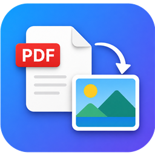

<div align="center">



# PDF Converter

**PDF / Word 文書のページを高品質な画像へ変換する、シンプルな Windows アプリ**

[](#)
[](#)
[](#)
[](#)
[-2C68C4?logo=windowsxp&logoColor=white)](#)
[-FF5722)](#)
[](LICENSE)

</div>

---

## ✨ 概要

**PDF Converter** は、PDF または Word 文書の各ページを **PNG / JPEG / BMP** の画像として書き出せる WPF デスクトップアプリです。
Word ファイルは Microsoft Word または LibreOffice で PDF に変換したうえで画像化します。レンダリングには [PDFium](https://pdfium.googlesource.com/pdfium/) ([PDFiumCore](https://github.com/Dtronix/PDFiumCore)) を採用します。変換前にプレビューを確認しながら、解像度や出力範囲を細かく指定できます。

---

## 🚀 主な機能

| | 機能 | 説明 |
|:---:|:---|:---|
| 🖼️ | **ページプレビュー** | 変換前に各ページを表示。前後移動・ページ番号ジャンプに対応 |
| 🗂️ | **柔軟な出力範囲** | 単一ページ・ページ範囲 (例: `1-3,5`)・全ページの保存 |
| 📐 | **解像度の指定** | 幅 (px) / 高さ (px) / DPI で出力サイズをコントロール |
| 🎨 | **複数の画像形式** | `PNG` / `JPEG` / `BMP` を選択可能 |
| 🫧 | **透過の保持** | PNG 出力時に背景の透明度を保持 |
| ⚡ | **並列処理** | CPU コア数に応じてページを並列レンダリングし高速保存 |
| 📋 | **クリップボードコピー** | プレビュー画像をワンクリックでコピー |
| 📄 | **Word 対応** | `.doc` / `.docx` を Word または LibreOffice 経由で PDF 化し、画像へ変換 |
| 🖱️ | **ドラッグ＆ドロップ** | PDF / Word をウィンドウへドロップするだけで読み込み |
| 🚀 | **コマンドライン起動** | 起動時引数で PDF / Word を指定し、開いた状態で起動 |
| ⚙️ | **バッチ / ヘッドレス** | `--output` などのオプションで GUI なしの一括変換に対応 |
| 🌗 | **テーマ切替** | ライト / ダーク / システム設定に追従 |
| 🧠 | **メモリキャッシュ** | 64 MB 以下の PDF をメモリにキャッシュし、I/O を削減 |
| 🛑 | **キャンセル対応** | 処理途中での中断が可能 |
| ♿ | **アクセシビリティ** | スクリーンリーダー対応 (ラベル関連付け・Live Region によるステータス読み上げ) |
| 🔄 | **更新確認** | バージョン情報から最新インストーラーを確認・ダウンロードして適用 |

---

## 🛠️ 技術スタック

<div align="left">


</div>

- **アーキテクチャ**: MVVM (パネル単位の View / ViewModel、`MainViewModelCoordinatorHost` による Coordinator 連携、Service の責務分離)
- **DI コンテナ**: `Microsoft.Extensions.DependencyInjection`
- **PDF レンダリング**: `PDFiumCore` (PDFium、[pdfium-binaries](https://github.com/bblanchon/pdfium-binaries) のビルドを同梱)
- **Word → PDF 変換**: Microsoft Word COM または LibreOffice headless (設定で切り替え)
- **ダイアログ**: `Ookii.Dialogs.Wpf`
- **テスト**: `xUnit v3` + `Moq` による単体テスト (`PdfConverter.Tests`)

---

## 📦 必要要件

- Windows 10 / 11 (x86 / x64 いずれのビルドも利用可能)
- .NET ランタイムのインストールは不要 (アプリに同梱する self-contained 配布)
- Word ファイルを変換する場合: **Microsoft Word** (デスクトップ版) または **LibreOffice** のいずれか
- LibreOffice 使用時: 一般的なインストール先から `soffice.exe` を自動検出 (必要に応じてアプリ内でパス指定可能)
- ビルドする場合: [.NET SDK 10](https://dotnet.microsoft.com/download/dotnet/10.0) 以降 (Visual Studio 2026 など SDK 10 を含む環境でも可)
- インストーラーを作成する場合: [Inno Setup 6](https://jrsoftware.org/isinfo.php)

---

## 🏗️ ビルド & 実行

ソリューションは `src/PdfConverter.slnx` を使用します。ビルドには .NET SDK 10 以降 (dotnet CLI) が必要です。

```powershell
# リポジトリの取得
git clone <repo_url>
cd pdf-converter

# (任意) 更新ダウンロード用キーを埋め込む
# UpdateReleaseKey.local.props.example を UpdateReleaseKey.local.props にコピーして
# PdfConverterReleaseKey を設定するか、環境変数 PDF_CONVERTER_KEY を設定する
# (キー未設定でもビルド・起動は可能。更新の「適用」時のみ失敗する)

# ビルド (Release / x64 構成 — 既定)。パッケージ復元も自動で行われる
dotnet build src/PdfConverter.slnx -c Release -p:Platform=x64

# x86 向けにビルドする場合
dotnet build src/PdfConverter.slnx -c Release -p:Platform=x86

# 配布用の出力 (.NET ランタイム同梱) を作成する場合
dotnet publish src/PdfConverter/PdfConverter.csproj -c Release -p:Platform=x64 -o src/PdfConverter/bin/x64/publish
```

PDFium のネイティブ DLL (`pdfium.dll`) はプラットフォーム固有のため、**Any CPU 構成はサポートしていません**。ビルド時は `x64` または `x86` を明示してください (省略時は x64)。

アプリは .NET ランタイムを同梱する **self-contained** 構成でビルドされるため、実行環境に .NET のインストールは不要です。ビルド後、プラットフォームに応じて次の場所に `PDF Converter.exe` が生成されます。

| プラットフォーム | ビルド出力 | 配布用 (publish) 出力 |
|:---|:---|:---|
| `x64` | `src/PdfConverter/bin/x64/Release/` | `src/PdfConverter/bin/x64/publish/` |
| `x86` | `src/PdfConverter/bin/x86/Release/` | `src/PdfConverter/bin/x86/publish/` |

出力フォルダーは `PDF Converter.exe` と依存 DLL (`pdfium.dll` を含む) を同じ階層に置くフラット構成です。Release ビルドでは PDB は出力されません。

---

## 📦 インストーラー

[Inno Setup 6](https://jrsoftware.org/isinfo.php) を使ったセットアップ EXE を `installer/` から作成できます。管理者権限を要求しない**ユーザー単位インストール**で、`%LOCALAPPDATA%\Programs\PDF Converter` に配置されます。

```powershell
cd installer

# x64 版 (既定) — dotnet publish・インストーラー生成を一括実行
.\build-installer.ps1

# x86 と x64 の両方
.\build-installer.ps1 -Platform all

# publish 済みの出力をそのまま使う場合
.\build-installer.ps1 -SkipBuild

# ターミナル向け (完了後のキー入力待ちを省略)
.\build-installer.ps1 -NoPause
```

生成物は `dist/` に出力されます (例: `PdfConverter-x.x.x-x64-setup.exe`)。バージョン番号は `src/PdfConverter/Properties/AssemblyInfo.cs` から自動取得され、Inno Setup へ `/DAppVersion` として渡されます。`AppVersion` 未指定で `PdfConverter.iss` を直接コンパイルするとエラーになります。

| 項目 | 内容 |
|:---|:---|
| 前提条件 | なし (.NET ランタイムを同梱) |
| スタートメニュー | ショートカットを自動作成 |
| デスクトップショートカット | オプション |
| ファイル関連付け | オプション (`.pdf` / `.doc` / `.docx`) |
| ウィザード UI | 日本語 / 英語 |

---

## 📖 使い方

1. **ファイルを開く** — 次のいずれかの方法で PDF / Word を読み込む
   - `参照` ボタンからファイルを選択
   - ウィンドウへ **ドラッグ＆ドロップ**
   - コマンドライン引数で起動 (例: `"PDF Converter.exe" "C:\docs\sample.pdf"`)
2. **プレビュー確認** — ページを移動しながら出力内容をチェック
3. **出力設定** — 画像形式・解像度・透過の有無を指定
4. **範囲を選ぶ** — 単一ページ / 範囲指定 / 全ページから選択
5. **保存** — 出力先フォルダを指定して変換実行 (`page_1.png` のように連番出力。ページ番号は総ページ数の桁数までゼロ埋め)

### コマンドライン引数

#### GUI 起動

起動時に PDF / Word のパスを渡すと、アプリ起動後に自動で読み込みます。複数の引数が渡された場合は、先頭から順に検証し、最初の有効なパスを使用します。

```powershell
# 絶対パスで指定
& ".\PDF Converter.exe" "C:\docs\report.pdf"

# 相対パスでも指定可能 (起動時の作業ディレクトリ基準)
& ".\PDF Converter.exe" ".\sample.docx"
```

エクスプローラーで PDF / Word をこのアプリにドラッグする、または「プログラムから開く」に登録して使うこともできます。

#### バッチ / ヘッドレスモード

`--output` などのスイッチを 1 つでも指定すると、ウィンドウを表示せずに変換だけを実行して終了します。スクリプトやタスクスケジューラからの自動化に使えます。進捗やエラーは標準出力 / 標準エラーへ表示され、詳細は GUI モードと同じログファイルにも記録されます。

```powershell
# PDF の全ページを PNG 画像として出力
& ".\PDF Converter.exe" --output "C:\out" "C:\docs\report.pdf"

# ページ範囲・形式・解像度を指定 (-o=value 形式も可)
& ".\PDF Converter.exe" -o "C:\out" -f png -p "1-3,5" --resolution-mode width -r 1920 "report.pdf"

# 複数ファイルを一括変換 (各ファイルは <出力先>\<ファイル名>\page_1.png 形式)
& ".\PDF Converter.exe" -o "C:\out" "a.pdf" "b.pdf"

# Word を PDF として保存 (出力先に .pdf を指定するとそのパスへ直接保存)
& ".\PDF Converter.exe" --export-pdf -o "C:\out\proposal.pdf" "proposal.docx"

# 既存ファイルを上書き
& ".\PDF Converter.exe" -o "C:\out" --overwrite "report.pdf"

# 先頭が - のパスを渡す場合は -- で区切る
& ".\PDF Converter.exe" -o "C:\out" -- "-report.pdf"

# ヘルプを表示
& ".\PDF Converter.exe" --help
```

**出力先の構成**

| 入力 | 画像出力先 |
|:---|:---|
| 1 ファイル | `<出力先>\page_1.png`、`<出力先>\page_2.png`、… |
| 複数ファイル | `<出力先>\<ファイル名>\page_1.png`、… |

ページ番号は名前順に並べてもページ順になるよう、総ページ数の桁数までゼロ埋めします (例: 12 ページの PDF なら `page_01.png` ～ `page_12.png`)。

| オプション | 説明 |
|:---|:---|
| `--output`, `-o <path>` | 画像の出力先フォルダー、または PDF 出力先 (必須) |
| `--pages`, `-p <範囲>` | 出力ページ (例: `1-3,5`)。省略時は全ページ |
| `--format`, `-f <形式>` | `png` / `jpeg` (`jpg` 可) / `bmp` (省略時は保存済み設定) |
| `--resolution-mode <方式>` | `default` / `width` / `height` / `dpi` (省略時は保存済み設定) |
| `--resolution`, `-r <数値>` | 解像度の数値 (省略時は保存済み設定) |
| `--transparent` | 透明度を保持 (PNG のみ) |
| `--no-transparent` | 白背景に合成 |
| `--overwrite` | 既存ファイルを確認せず上書き |
| `--export-pdf` | Word を PDF として保存 (画像変換は行わない) |
| `--quiet`, `-q` | 進捗メッセージを抑制 |
| `--help`, `-h`, `/?`, `--?` | ヘルプを表示 |

オプションは `-o=value` / `--output=value` の形式でも指定できます。`--export-pdf` と `--pages` は同時に指定できません。

終了コード: `0` = 成功、`1` = 変換エラー、`2` = 引数エラー

### トラブルシューティング

問題が発生した場合、次のログを確認できます (UTF-8 テキスト、最大 2 MB でローテーション)。

| ファイル | 内容 |
|:---|:---|
| `%LOCALAPPDATA%\PDF Converter\logs\app.log` | 操作ログ・警告 |
| `%LOCALAPPDATA%\PDF Converter\logs\error.log` | エラーと例外の詳細 |

**よくあるエラー**

| 症状 | 原因と対処 |
|:---|:---|
| 「描画サイズが上限を超えています」と表示される | 1 ページあたりの描画画素数は x64 版で 3 億画素、x86 版で 1 億画素までです。解像度 (幅・高さ・DPI) を下げてください |
| パスワード付き・破損した PDF を開けない | パスワード付き PDF には対応していません。破損した PDF は修復してから読み込んでください |
| Word 文書の変換が失敗する・終わらない | Microsoft Word または LibreOffice がインストールされているか確認してください。変換は 5 分でタイムアウトします。LibreOffice は一時フォルダーの専用プロファイルで起動するため、起動中の LibreOffice には影響しません |

変換途中の一時ファイルは `%TEMP%\PdfConverter` 配下のインスタンスごとのフォルダーに作成され、終了時に削除されます。

ユーザー設定 (テーマ・画像出力・Word 変換など) は Windows のユーザー構成 (`user.config`) に保存されます。起動時に破損を検出すると既定値へ回復し、バージョンアップ時は旧設定を引き継ぎます。手動で初期化したい場合は、バージョン情報ダイアログの **設定をリセット** を使えます。

---

## 🧪 テスト

単体テストは [xUnit.net v3](https://xunit.net/) で実装されています。テストプロジェクトは **`net10.0-windows`** で、ビルド後に生成されるテスト実行ファイルを直接起動して実行できます。

```powershell
cd installer

# 復元・ビルド・テストを一括実行 (推奨)
.\build-and-test.ps1

# Release 構成で実行
.\build-and-test.ps1 -Configuration Release

# x86 向けに実行 / 復元を省略 / 完了後のキー入力待ちを省略
.\build-and-test.ps1 -Platform x86 -SkipRestore -NoPause
```

手動で実行する場合:

```powershell
# 1. テストプロジェクトをビルド (パッケージ復元も自動で行われる)
dotnet build src/PdfConverter.Tests/PdfConverter.Tests.csproj -c Debug -p:Platform=x64

# 2. テスト実行 (xUnit v3 In-Process Runner)
src/PdfConverter.Tests/bin/x64/Debug/net10.0-windows/PdfConverter.Tests.exe
```

Visual Studio のテストエクスプローラーからも実行できます (`xunit.runner.visualstudio` を使用)。

---

## 🤝 開発

- **コード解析**: `AnalysisLevel=10.0-recommended` のコード解析とコードスタイル検査を有効にしており、警告はビルドエラーになります。ルールの抑止は理由を添えて `.editorconfig` に記述します
- **Nullable 参照型**: アプリ本体で有効です。null を取り得る値は `?` で明示します
- **コーディング規約**: C# のセクション区切りコメントと日本語表記 (括弧・半角スペース) の規則は [`.claude/rules/`](.claude/rules/) を参照してください
- **自動生成ファイル**: `Settings.Designer.cs` / `Resources.Designer.cs` は手で編集しません
- **ブランチ**: `develop` から `feature/<name>` / `fix/<name>` などを作成し、PR で `develop` へマージします
- **コミットメッセージ**: `Update: ...` / `Fix: ...` 形式。機能変更時は [CHANGELOG.md](CHANGELOG.md) を更新します
- **PDFiumCore の更新**: `installer/licenses/PDFium.txt` を同じバージョンの [pdfium-binaries](https://github.com/bblanchon/pdfium-binaries/releases) リリースのライセンスに差し替えます (不一致は `generate-third-party-notices.ps1` がエラーにします)

---

## 📂 プロジェクト構成

```text
pdf-converter/
├─ src/
│  ├─ PdfConverter.slnx            # ソリューション
│  ├─ Directory.Build.props        # 全プロジェクト共通の MSBuild 設定
│  ├─ PdfConverter/                # アプリ本体 (WPF / MVVM)
│  │  ├─ Commands/                 # コマンド実装
│  │  ├─ Converters/               # 値変換
│  │  ├─ Infrastructure/           # ログ・例外処理・DI 構成・設定初期化・起動補助・CLI 解析
│  │  │  ├─ BatchCliParser.cs      # バッチ / ヘッドレスモードの引数解析
│  │  │  ├─ BatchCliOptions.cs     # バッチモードのオプション
│  │  │  └─ BatchConsoleHelper.cs  # バッチモードのコンソール出力
│  │  ├─ Models/                   # ドメインモデル / 列挙型
│  │  ├─ Properties/               # AssemblyInfo・リソース・ユーザー設定定義
│  │  ├─ Services/                 # 変換・I/O・Word/LibreOffice 連携・バッチ変換・更新確認
│  │  │  ├─ PdfConversionService.cs                # PDF の読み込み・描画・画像保存
│  │  │  ├─ PdfiumDocument.cs                      # PDFium のラッパー
│  │  │  ├─ MicrosoftWordToPdfConversionService.cs # Word COM による PDF 変換
│  │  │  ├─ LibreOfficeToPdfConversionService.cs   # LibreOffice headless による PDF 変換
│  │  │  ├─ BatchExportService.cs                  # バッチ / ヘッドレスモードの変換実行
│  │  │  └─ UpdateService.cs                       # 更新確認・ダウンロード
│  │  ├─ Themes/                   # ライト / ダークテーマ
│  │  ├─ ViewModels/               # ViewModel 群
│  │  │  ├─ Coordinators/          # プレビュー・保存フローの調停
│  │  │  ├─ MainViewModel.cs       # メイン画面の統合 ViewModel
│  │  │  ├─ MainViewModelCoordinatorHost.cs  # Coordinator 向けホスト実装
│  │  │  ├─ PreviewPanelViewModel.cs
│  │  │  ├─ ImageExportSettingsViewModel.cs
│  │  │  ├─ WordConversionSettingsViewModel.cs
│  │  │  ├─ ThemeSettingsViewModel.cs
│  │  │  └─ StatusBarViewModel.cs
│  │  ├─ Views/                    # 画面 (XAML)
│  │  │  ├─ Panels/                # メイン画面を構成する各パネル
│  │  │  ├─ Behaviors/             # UI ビヘイビア (D&D など)
│  │  │  ├─ MainWindow.xaml        # メイン画面
│  │  │  ├─ AboutDialog.xaml       # バージョン情報・更新確認・設定リセット
│  │  │  ├─ DropOverlay.xaml       # ドロップ受付オーバーレイ
│  │  │  └─ ConfirmDialog.xaml     # 確認ダイアログ
│  │  ├─ Assets/                   # アイコンなどのリソース
│  │  └─ UpdateReleaseKey.local.props.example  # 更新ダウンロード用キーの設定例
│  └─ PdfConverter.Tests/          # xUnit v3 単体テスト
│     ├─ Commands/
│     ├─ Converters/
│     ├─ Infrastructure/
│     ├─ Services/
│     ├─ Themes/
│     ├─ ViewModels/
│     │  └─ Coordinators/
│     ├─ Views/
│     │  └─ Behaviors/
│     └─ Helpers/                  # テスト補助
├─ installer/                      # Inno Setup スクリプトとビルド用 PowerShell
│  ├─ PdfConverter.iss
│  ├─ build-common.ps1             # .NET SDK 検出・復元など共通関数
│  ├─ build-installer.ps1          # インストーラー生成
│  ├─ build-and-test.ps1           # 復元・ビルド・テスト一括実行
│  ├─ generate-third-party-notices.ps1  # THIRD-PARTY-NOTICES.txt の生成
│  └─ licenses/                    # NuGet パッケージに含まれないライセンス全文
├─ dist/                           # インストーラー出力先 (gitignore 対象)
├─ .claude/rules/                  # コーディング規約 (セクションコメント・日本語表記)
├─ .editorconfig                   # コードスタイル・コード解析ルール
├─ CHANGELOG.md                    # 変更履歴
├─ CLAUDE.md                       # 開発ガイド (AI エージェント向け)
├─ LICENSE
└─ README.md
```

---

## 📜 ライセンス

本プロジェクトは [MIT License](LICENSE) の下で公開されています。

### オープンソースソフトウェア

本アプリは以下のオープンソースコンポーネントを使用しています。

| コンポーネント | バージョン | ライセンス | 用途 |
|:---|:---|:---|:---|
| PDFiumCore | 156.0.8076 | Apache 2.0 | PDF レンダリング (.NET バインディング) |
| PDFium | 156.0.8076 | BSD-3-Clause / Apache 2.0 | PDF ネイティブエンジン (pdfium-binaries) |
| Microsoft.Extensions.DependencyInjection | 10.0.8 | MIT | DI コンテナ |
| Microsoft.Extensions.DependencyInjection.Abstractions | 10.0.8 | MIT | DI 抽象化 |
| Ookii.Dialogs.Wpf | 5.0.1 | BSD-3-Clause | フォルダー選択ダイアログ |
| .NET Runtime / Windows Desktop Runtime | 10 | MIT | 実行ランタイム (self-contained で同梱) |

インストール版には `THIRD-PARTY-NOTICES.txt` が同梱され、各コンポーネントのライセンス全文が記載されています。アプリ右上の **ⓘ ボタン** (バージョン情報) からも開けます。

バージョン情報ダイアログの **更新を確認** から、公開中の最新インストーラーを確認できます。更新を適用するとインストーラーを起動したうえでアプリを終了します。

### 外部ソフトウェア

以下はユーザーの環境に別途インストールが必要です (本アプリに同梱されません)。

- **Microsoft Word** — Word 文書の変換時 (COM 利用。正規ライセンスが必要)
- **LibreOffice** — Word 文書の変換時の代替手段

### 商標

PDF は Adobe Inc. の登録商標です。Microsoft、Word、Windows は Microsoft Corporation の米国およびその他の国における登録商標または商標です。LibreOffice は The Document Foundation の商標です。これらの名称は、各権利者との提携・後援・承認を示すものではありません。
